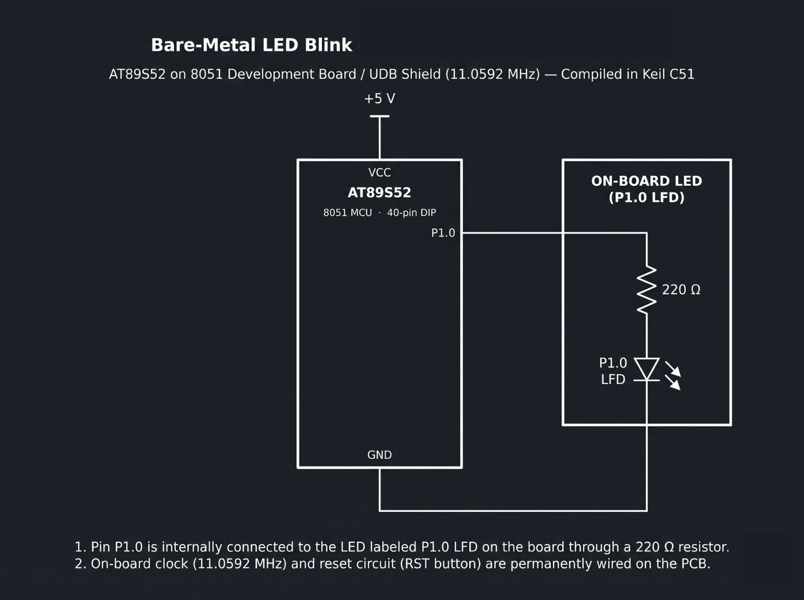

# Continuous Lab Evaluation - 2

**EXP:** Continuous Lab Evaluation - 2  
**DATE:** 20/07/2026  
**NAME OF EXP:** 8051 Tool Chain Setup and GPIO Bring-Up on AT89S52  
**HARDWARE SETUP / PLATFORM:** Keil C51 + AT89S52 Microcontroller Development Board (11.0592 MHz) + On-board LED  
**TASK NO:** 2B  

---

### Circuit Diagram


---

### Core Logic

* **1. SFR Pin Mapping and Bit-Level Direct Addressing**  
  The Special Function Register header `<reg51.h>` defines the register layout. The `sbit` compiler intrinsic maps the symbolic identifier `USER_LED` directly to Port 1 bit 0 (`P1^0`), enabling single-instruction bit manipulation (`SETB`/`CLR`).
  ```c
  #include <reg51.h>

  sbit USER_LED = P1^0;
  ```

* **2. Calibrated Blocking Loop Delay**  
  An unrolled two-tier nested loop introduces a deterministic timing delay based on machine cycle consumption, achieving a stable ~500 ms duration per phase without requiring hardware timer initialization.
  ```c
  static void delay_cycles(unsigned int cycles) {
      unsigned int outer, inner;
      for (outer = 0; outer < cycles; outer++) {
          for (inner = 0; inner < 475; inner++) {
              /* Burn CPU machine cycles */
          }
      }
  }
  ```

* **3. Super-Loop Execution Flow**  
  The infinite runtime loop toggles the LED pin between logic `1` and `0` with symmetrical delays, yielding a visible ~1.0 Hz square-wave blink pattern.
  ```c
  while (1) {
      USER_LED = 1;
      delay_cycles(500);
      USER_LED = 0;
      delay_cycles(500);
  }
  ```

---

### Inference
Direct bit-level addressing via the `sbit` directive provides an efficient mechanism for controlling AT89S52 general-purpose I/O lines without read-modify-write side effects on adjacent port pins. The calibrated software loop demonstrated reliable, visible 1 Hz flashing, successfully validating the toolchain pipeline, compiler settings, and hex generation for the target hardware platform.
