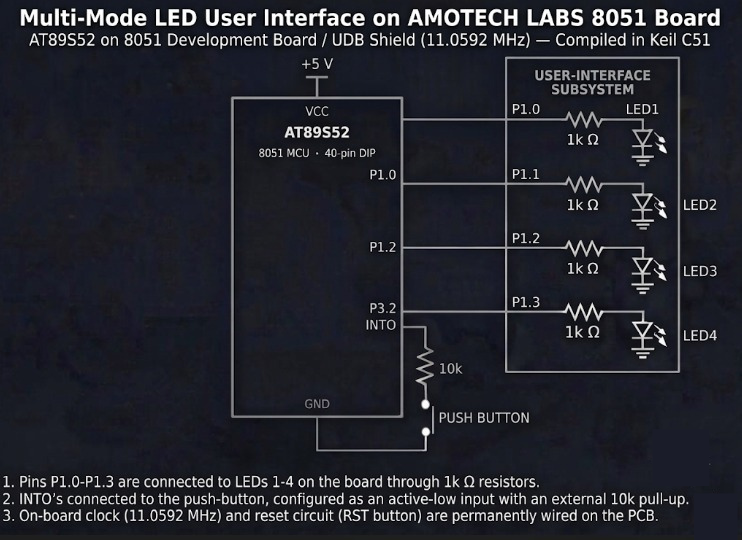

# Continuous Lab Evaluation - 3

**EXP:** Continuous Lab Evaluation - 3  
**DATE:** 27/07/2026  
**NAME OF EXP:** Timer-Based LED Pattern Generator and Button Interrupt Controller  
**HARDWARE SETUP / PLATFORM:** AT89S52 Microcontroller Development Board + Keil C51 + 4 Active-Low LEDs + Pushbutton Switch + Multimeter  
**TASK NO:** 3A  

---

### Circuit Diagram


---

### Core Logic

* **1. Active-Low Port Masking and Inversion**  
  Because the LEDs are wired in active-low sink configuration, logical high bits must be inverted. Port masking (`PORT3_IO & 0xF0`) preserves the upper nibble so that pushbutton pin `P3.4` maintains its quasi-bidirectional pull-up state.
  ```c
  static void apply_led_pattern(unsigned char pattern) {
      PORT3_IO = (PORT3_IO & 0xF0) | ((~pattern) & 0x0F);
  }
  ```

* **2. Edge-Triggered Button Debouncing**  
  A double-check delay filter (25 ms) eliminates contact bounce artifacts. Holding execution until switch release (`while (PUSH_BUTTON == 0)`) prevents rapid multi-triggering, ensuring a single clean state advance per user actuation.
  ```c
  static unsigned char poll_button_press(void) {
      if (PUSH_BUTTON == 0) {
          pause_ms(25);
          if (PUSH_BUTTON == 0) {
              while (PUSH_BUTTON == 0);
              pause_ms(25);
              return 1;
          }
      }
      return 0;
  }
  ```

* **3. Deterministic Finite State Machine (FSM)**  
  The main loop executes a 5-state FSM. State 0 represents idle/off, while States 1–4 generate ring shift, binary counting, alternating strobe, and group blinking sequences with automatic wraparound.
  ```c
  switch (active_mode) {
      case 0: apply_led_pattern(0x00); break;
      case 1: apply_led_pattern(1 << anim_phase); anim_phase = (anim_phase + 1) % 4; break;
      case 2: apply_led_pattern(counter_val & 0x0F); counter_val = (counter_val + 1) & 0x0F; break;
      case 3: apply_led_pattern(anim_phase ? 0x05 : 0x0A); anim_phase ^= 1; break;
      case 4: apply_led_pattern(anim_phase ? 0x00 : 0x0F); anim_phase ^= 1; break;
  }
  ```

---

### Inference
Integrating active-low bitmasking with release-edge debouncing yielded a robust, glitch-free user interface. The AT89S52 successfully coordinates multiple dynamic lighting sequences while isolating input state from output drives on shared 8-bit port registers.
