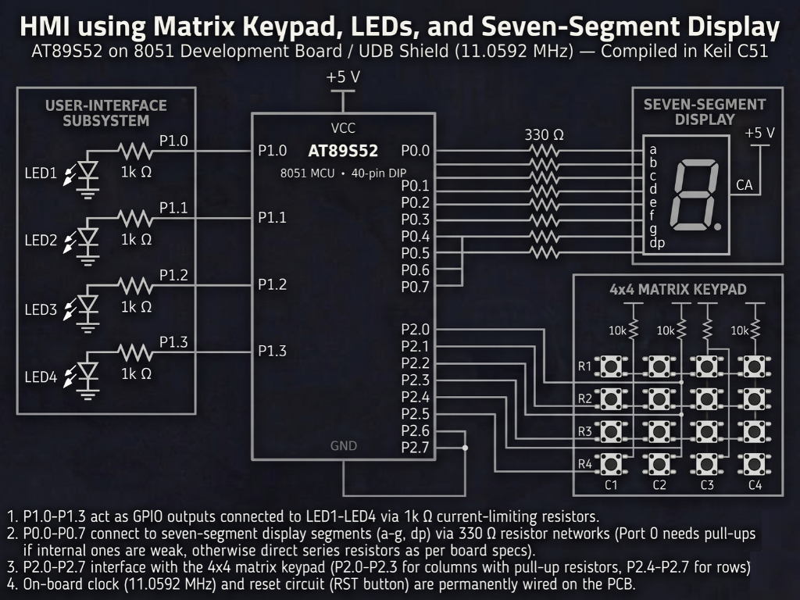

# Continuous Lab Evaluation - 4

**EXP:** Continuous Lab Evaluation - 4  
**DATE:** 03/08/2026  
**NAME OF EXP:** Human-Machine Interface using Matrix Keypad, LEDs, and Seven-Segment Display  
**HARDWARE SETUP / PLATFORM:** AT89S52 Development Board + 4x4 Matrix Keypad + 7-Segment Display + 8-Bit LED Array  
**TASK NO:** 4A  

---

### Circuit Diagram


---

### Core Logic

* **1. Row-Strobed Column-Sense Matrix Scanning**  
  Port 2 pins `P2.7..P2.4` serve as driven row lines while `P2.3..P2.0` operate as weakly pulled-up column sense inputs. Each row is strobed low sequentially; active low logic on column inputs indicates key closure.
  ```c
  for (r = 0; r < 4; r++) {
      P2 = 0xFF;
      P2 &= ~(1 << ROW_BITS[r]);
      for (c = 0; c < 4; c++) {
          if ((P2 & (1 << COL_BITS[c])) == 0) {
              /* Key closure registered */
          }
      }
  }
  ```

* **2. Common-Cathode Seven-Segment Decoding**  
  Port 0 is mapped to segment lines A–G. A static hexadecimal lookup table converts numeric mode values `0–9` to respective active-high segment masks:
  ```c
  static const unsigned char SEGMENT_MAP[10] = {
      0x3F, 0x06, 0x5B, 0x4F, 0x66, 0x6D, 0x7D, 0x07, 0x7F, 0x6F
  };
  P0 = (num >= 0 && num <= 9) ? SEGMENT_MAP[num] : 0x00;
  ```

* **3. Non-Blocking Key Interception During Animations**  
  To ensure responsive user interactions, lengthy display routines (e.g., binary counter or running chaser) utilize `scan_keypad_nonblocking()`, allowing immediate preemption as soon as any key is pressed.
  ```c
  static int scan_keypad_nonblocking(unsigned int wait_ms) {
      unsigned int elapsed = 0;
      while (elapsed < wait_ms) {
          int pressed = scan_matrix_keypad();
          if (pressed != -1) return pressed;
          delay_ms(10);
          elapsed += 10;
      }
      return -1;
  }
  ```

---

### Inference
A comprehensive bare-metal human-machine interface was successfully implemented. Coordinated multiplexing of keypad row/column inputs alongside non-blocking pattern delays achieved fluid state transitions, synchronized 7-segment visualization, and responsive mode execution without latency.
