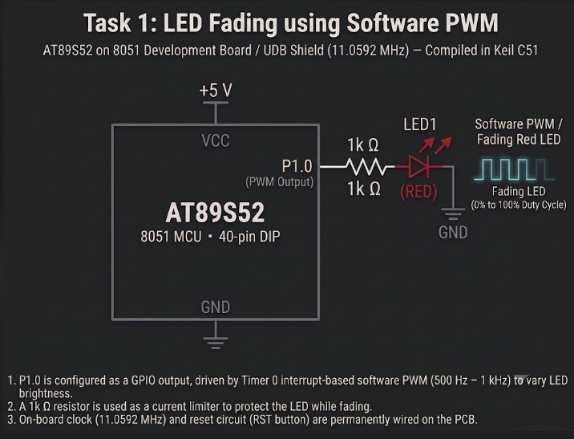

# Continuous Lab Evaluation - 5

**EXP:** Continuous Lab Evaluation - 5  
**DATE:** 10/08/2026  
**NAME OF EXP:** Hardware Timer and Interrupt-Based Timing for LED Fading  
**HARDWARE SETUP / PLATFORM:** Keil uVision + AT89S52 Development Board (11.0592 MHz) + LED + Oscilloscope  
**TASK NO:** 5A (Task 1)  

---

### Circuit Diagram


---

### Core Logic

* **1. Periodic Timer 0 Reload & Tick Generation**  
  Timer 0 is configured in 16-bit Mode 1 (`TMOD |= 0x01`). Preloading `TH0 = 0xFF` and `TL0 = 0xF7` generates an accurate periodic interrupt every ~100 µs.
  ```c
  void isr_timer0(void) interrupt 1 {
      TH0 = 0xFF;
      TL0 = 0xF7;
      /* PWM evaluation */
  }
  ```

* **2. 100-Step Software PWM Modulation**  
  Within each interrupt, an 8-bit accumulator (`pwm_phase`) compares against `target_duty`. When the phase is below the duty threshold, the pin is driven high; otherwise, it is grounded.
  ```c
  if (pwm_phase < target_duty) {
      FADE_LED = 1;
  } else {
      FADE_LED = 0;
  }
  ```

* **3. Dual-Slope Triangular Fading Profile**  
  A prescaler decimation counter scales the duty cycle increment/decrement steps at 10 ms intervals, smoothly sweeping duty from 0% to 100% and back to create a breathing visual effect.
  ```c
  if (step_prescaler >= 10) {
      step_prescaler = 0;
      if (ramp_up) {
          if (++target_duty >= 100) ramp_up = 0;
      } else {
          if (--target_duty == 0) ramp_up = 1;
      }
  }
  ```

---

### Inference
Hardware timer interrupts provide steady, deterministic timebases for synthesizing pulse-width modulated waveforms. By offloading timing to Timer 0 ISR, smooth LED fading was achieved with zero jitter and without consuming foreground CPU execution cycles.
