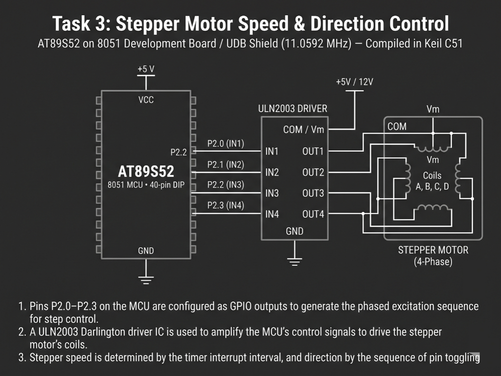

# Continuous Lab Evaluation - 5

**EXP:** Continuous Lab Evaluation - 5  
**DATE:** 10/08/2026  
**NAME OF EXP:** Hardware Timer and Interrupt-Based Timing — Stepper Motor Control  
**HARDWARE SETUP / PLATFORM:** AT89S52 + Keil C51 + ULN2003 Driver + 4-Phase Unipolar Stepper Motor + Matrix Keypad  
**TASK NO:** 5C (Task 3)  

---

### Circuit Diagram


---

### Core Logic

* **1. Wave Drive Commutation Sequence**  
  A circular 4-element lookup table sequentially energizes motor stator coils A, B, C, and D through buffer lines on `P1.3..P1.0`.
  ```c
  static const unsigned char COIL_PHASES[4] = {0x08, 0x04, 0x02, 0x01};
  P1 = (P1 & 0xF0) | COIL_PHASES[phase_ptr];
  phase_ptr = (phase_ptr + 1) % 4;
  ```

* **2. Prescaled Timer 0 Step Clock**  
  Timer 0 fires a base 1 ms interrupt. A software prescaler variable (`speed_prescaler`) adjusts the step period, allowing smooth speed regulation without stalling.

* **3. Dynamic Keypad Velocity Switching**  
  The main loop polls Keypad Row 0:
  - **Key 1**: Fast rotation (`speed_prescaler = 1`)
  - **Key 2**: Moderate rotation (`speed_prescaler = 3`)
  - **Key 3**: Controlled slow rotation (`speed_prescaler = 6`)

---

### Inference
Decoupling motor commutation timing into an interrupt service routine guarantees precise phase alignment, preventing missed steps caused by foreground loop delays. The matrix keypad provides intuitive, real-time speed adaptation.
