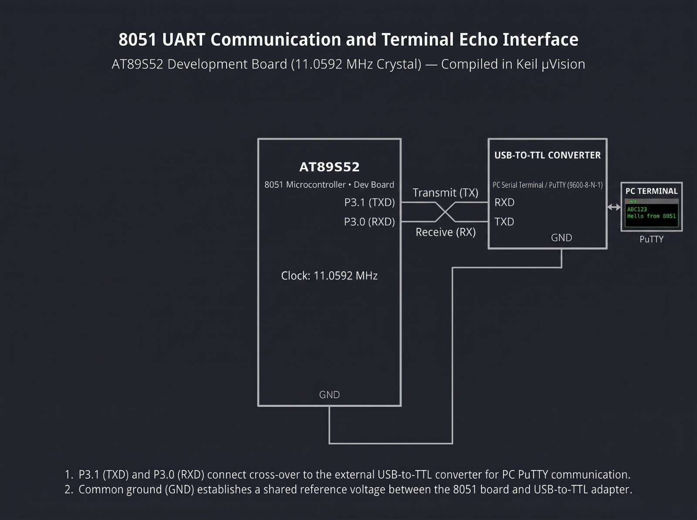

# Continuous Lab Evaluation - 6

**EXP:** Continuous Lab Evaluation - 6  
**DATE:** 17/08/2026  
**NAME OF EXP:** UART Driver and Serial Debugging — UART Initialization and Character Transmission  
**HARDWARE SETUP / PLATFORM:** AT89S52 Development Board (11.0592 MHz) + USB-to-UART Bridge (FTDI/CH340) + PC Terminal (PuTTY)  
**TASK NO:** 6A (Task A)  

---

### Circuit Diagram


---

### Core Logic

* **1. Timer 1 Mode 2 Auto-Reload Baud Generator**  
  Configuring `TMOD |= 0x20` operates Timer 1 as an 8-bit auto-reload counter. With an 11.0592 MHz oscillator, setting `TH1 = 0xFD` generates an exact 9600 baud clock frequency with 0.0% error rate:
  $$\text{Reload Value} = 256 - \left(\frac{11059200}{384 \times 9600}\right) = 256 - 3 = 253 = \text{0xFD}$$
  ```c
  void uart_configure(void) {
      SCON = 0x50;  // 8-bit UART, REN enabled
      TMOD = (TMOD & 0x0F) | 0x20;
      TH1 = 0xFD;
      TR1 = 1;
  }
  ```

* **2. Polling-Driven Character Transmission**  
  Writing data to `SBUF` triggers serial shift transmission. The software polls the hardware transmit flag (`TI`) until the stop bit is transmitted, then clears the flag for the next byte:
  ```c
  void uart_send_byte(char ch) {
      SBUF = ch;
      while (!TI);
      TI = 0;
  }
  ```

* **3. Stream String Dispatcher**  
  Pointer incrementation dispatches strings sequentially until the null-terminator (`\0`) is encountered.

---

### Inference
Direct register configuration of `SCON`, `TMOD`, and `TH1` successfully brings up full-duplex asynchronous communication on the 8051. The verified transmission pipeline enables low-overhead telemetry and serial terminal logging.
