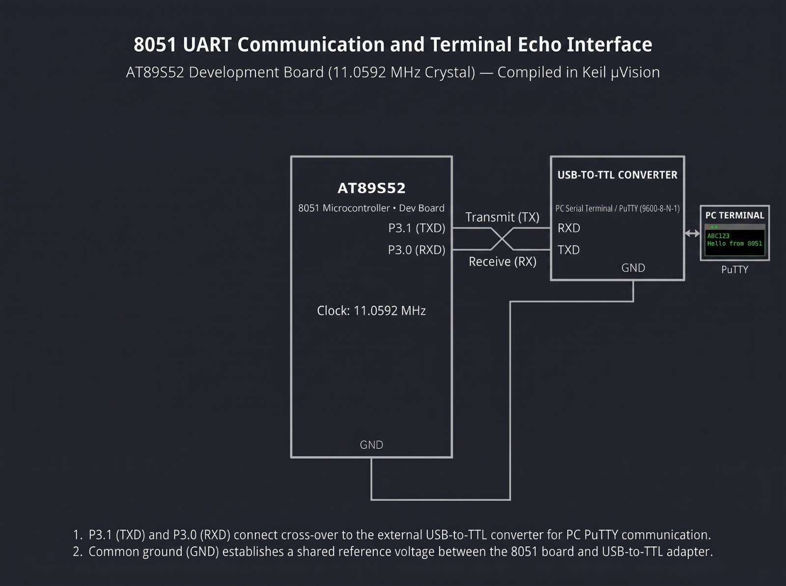

# Continuous Lab Evaluation - 6

**EXP:** Continuous Lab Evaluation - 6  
**DATE:** 17/08/2026  
**NAME OF EXP:** UART Driver and Serial Debugging — UART Echo  
**HARDWARE SETUP / PLATFORM:** AT89S52 Microcontroller + USB-to-TTL Serial Adapter + Terminal Emulator  
**TASK NO:** 6B (Task B)  

---

### Circuit Diagram


---

### Core Logic

* **1. Interrupt Vector 4 Serial Service Routine**  
  Enabling `ES = 1` and `EA = 1` allows the AT89S52 to branch immediately to interrupt vector `0x0023` whenever a byte arrives in `SBUF` or when a byte finishes transmitting.
  ```c
  void isr_serial_comms(void) interrupt 4 {
      if (RI) {
          RI = 0;
          rx_char_buffer = SBUF;
          SBUF = rx_char_buffer; // Immediate hardware echo
      }
      if (TI) {
          TI = 0;
      }
  }
  ```

* **2. Full-Duplex Loopback Arbitration**  
  Because `RI` and `TI` share the same interrupt vector, independent conditional checking prevents flag masking and avoids dropped frames during bi-directional streaming.

---

### Inference
Interrupt-driven reception avoids the CPU starvation associated with blocking poll loops. Characters sent from a host terminal are echoed instantaneously with sub-microsecond response latency, validating the interrupt arbitration architecture of the 8051 core.
