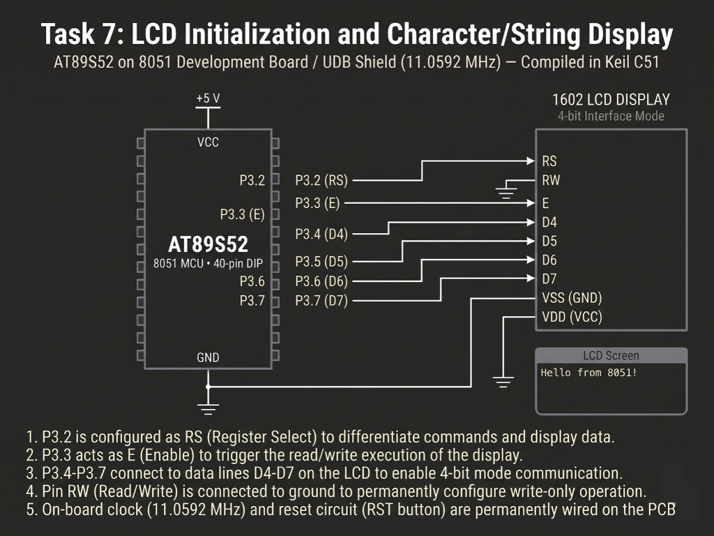

# Continuous Lab Evaluation - 7

**EXP:** Continuous Lab Evaluation - 7  
**DATE:** 24/08/2026  
**NAME OF EXP:** 16×2 LCD Driver Development and Dynamic Display Control  
**HARDWARE SETUP / PLATFORM:** AT89S52 + HD44780-Compatible 16×2 Alphanumeric LCD + Keil C51  
**TASK NO:** 7A (Static Display)  

---

### Circuit Diagram


---

### Core Logic

* **1. 4-Bit Parallel Bus Multiplexing**  
  Data nibbles are mapped to pins `P3.4..P3.7`, while Register Select (`RS`) and Enable (`EN`) occupy `P3.2` and `P3.3`. A single 8-bit command is split into MSB and LSB nibbles:
  ```c
  static void lcd_latch_nibble(unsigned char nibble, bit is_data) {
      LCD_RS = is_data;
      P3 = (P3 & 0x0F) | ((nibble & 0x0F) << 4);
      LCD_EN = 1;
      _nop_(); _nop_();
      LCD_EN = 0;
  }
  ```

* **2. Standard HD44780 Initialization Sequence**  
  Following the official Hitachi timing sequence, three consecutive `0x03` nibbles followed by `0x02` force the LCD into 4-bit operating mode regardless of its power-on state.

* **3. DDRAM Addressing**  
  Line 1 begins at DDRAM address `0x80`, while Line 2 begins at `0xC0`. Commands `0x28` (Function Set) and `0x0C` (Display Control) ensure clean visual presentation.

---

### Inference
Operating the HD44780 display in 4-bit mode conserves precious microcontroller pins (4 data pins instead of 8) while maintaining crisp alphanumeric readability, verifying the timing parameters of the parallel LCD bus.
