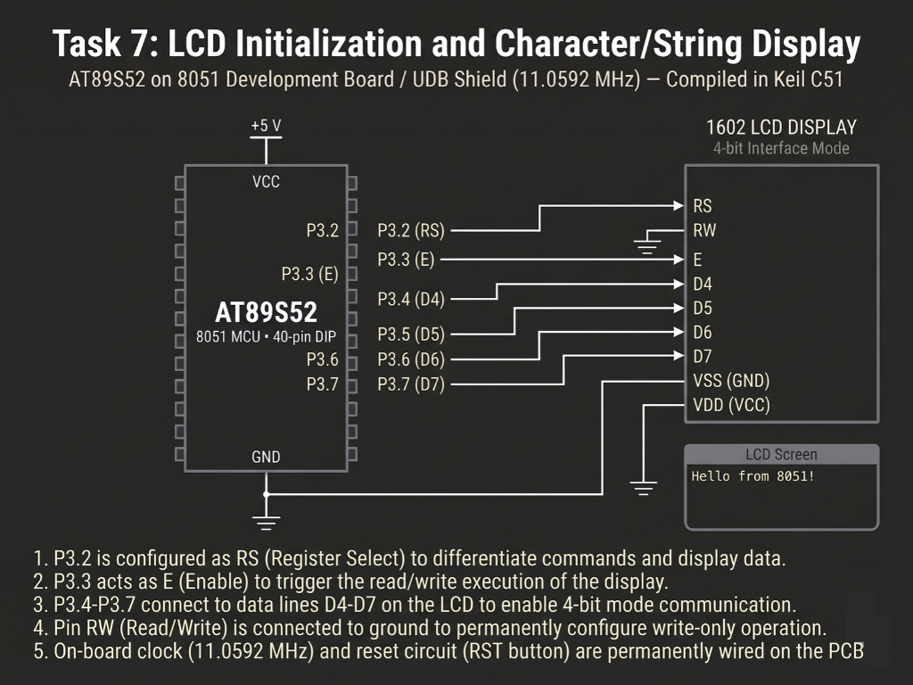

# Continuous Lab Evaluation - 7

**EXP:** Continuous Lab Evaluation - 7  
**DATE:** 24/08/2026  
**NAME OF EXP:** 16×2 LCD Driver Development and Dynamic Display Control  
**HARDWARE SETUP / PLATFORM:** AT89S52 + 16×2 Character LCD + Variable Potentiometer (Contrast) + Keil C51  
**TASK NO:** 7B (Multi-Line & Numeric Display)  

---

### Circuit Diagram


---

### Core Logic

* **1. Arbitrary Row/Column Cursor Relocation**  
  Translates matrix row/column coordinates into internal HD44780 DDRAM offsets (`0x80` base for Row 0, `0xC0` base for Row 1):
  ```c
  void lcd_set_cursor(unsigned char row, unsigned char col) {
      unsigned char addr = (row == 0) ? 0x80 : 0xC0;
      lcd_cmd(addr + (col & 0x0F));
  }
  ```

* **2. Radix-10 Integer Conversion**  
  A lightweight numeric rendering function decomposes integers into ASCII decimal characters without relying on heavyweight standard `printf` libraries, minimizing code footprint in flash:
  ```c
  void lcd_print_int(unsigned int val) {
      char buf[6];
      int idx = 0;
      if (val == 0) { lcd_data('0'); return; }
      while (val > 0) { buf[idx++] = (val % 10) + '0'; val /= 10; }
      while (idx > 0) { lcd_data(buf[--idx]); }
  }
  ```

* **3. Dynamic Line Refresh**  
  Top banner remains persistent while bottom line updates dynamically at 500 ms intervals.

---

### Inference
Custom cursor-positioning and lightweight integer conversion routines provide real-time numeric reporting without standard library overhead, making dynamic instrumentation feasible on memory-constrained 8051 hardware.
