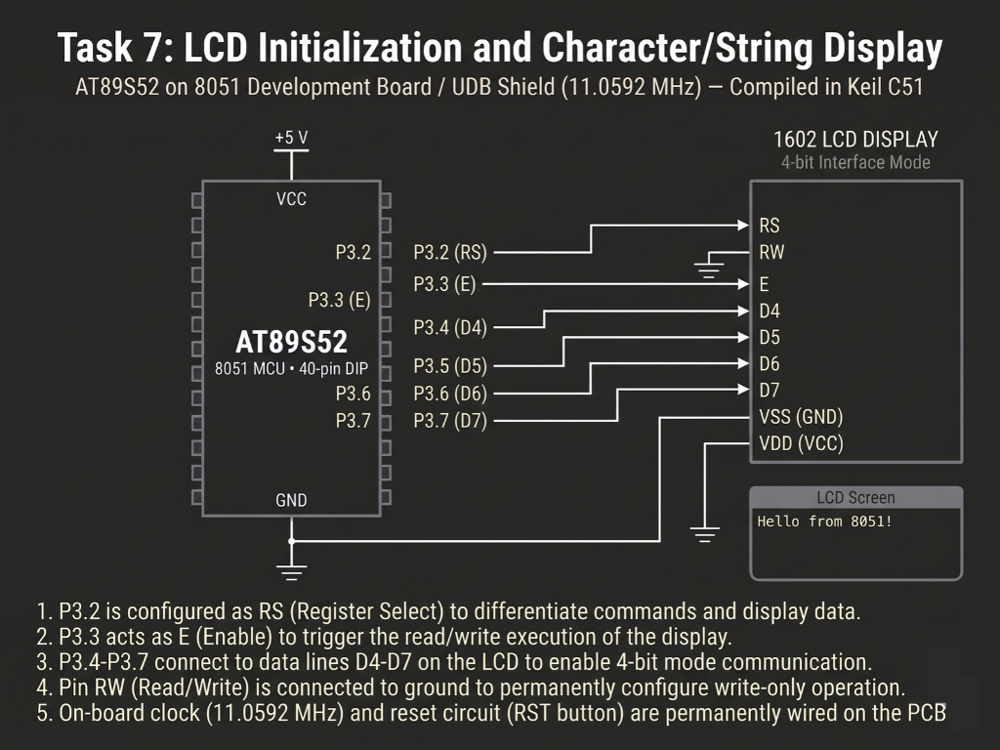

# Continuous Lab Evaluation - 7

**EXP:** Continuous Lab Evaluation - 7  
**DATE:** 24/08/2026  
**NAME OF EXP:** 16×2 LCD Driver Development and Dynamic Display Control  
**HARDWARE SETUP / PLATFORM:** AT89S52 Microcontroller + HD44780 16×2 Display + Keil C51  
**TASK NO:** 7C (Dynamic Animation Traverser)  

---

### Circuit Diagram


---

### Core Logic

* **1. Matrix Coordinate Traversal**  
  A scanning algorithm increments the horizontal column index (`0..15`). Upon reaching the 16th cell, the column resets to 0 and the row index toggles between 0 and 1, creating a continuous snake-like progression across the two-line display grid:
  ```c
  col++;
  if (col >= DISPLAY_COLS) {
      col = 0;
      row ^= 1;
  }
  ```

* **2. Double-Buffered Visual Clearing**  
  Drawing the active glyph (`#`), awaiting the persistence interval (180 ms), and then overwriting the position with a whitespace character (`' '`) prevents ghosting or trail artifacts without needing a full-screen clear command (`0x01`).

---

### Inference
Local cell rewriting with space-character erasure enables smooth animation and moving indicators across the 16x2 matrix without the visual flicker caused by global display clearing commands.
