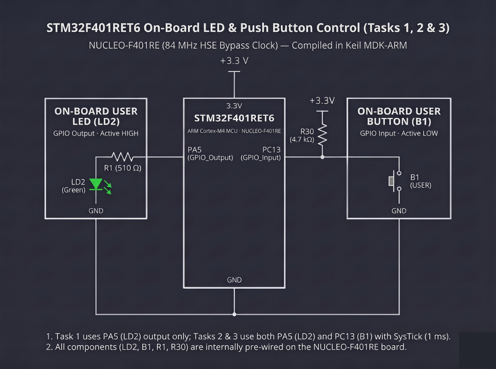

# Continuous Lab Evaluation - 12

**EXP:** Continuous Lab Evaluation - 12  
**DATE:** 20/10/2026  
**NAME OF EXP:** Short-Press and Long-Press Detection  
**HARDWARE SETUP / PLATFORM:** STM32 Nucleo-F103RB (User Button PC13, User LED PA5) + SysTick Timer  
**TASK NO:** 12C (Task 3)  

---

### Circuit Diagram

---

### Core Logic

* **1. Millisecond Duration Discrimination**  
  SysTick differential tracking measures actuation length:
  - **Short Press (< 1000 ms)**: Toggles standard output or resets blinking.
  - **Long Press (>= 1000 ms)**: Engages continuous 2 Hz asynchronous flashing.

* **2. Asynchronous State Servicing**  
  The background comparator keeps the LED flashing without blocking user button polling.

---

### Inference
Distinguishing between short taps and prolonged holds doubles the functional capability of a single input pin, providing an intuitive multi-functional control scheme.
