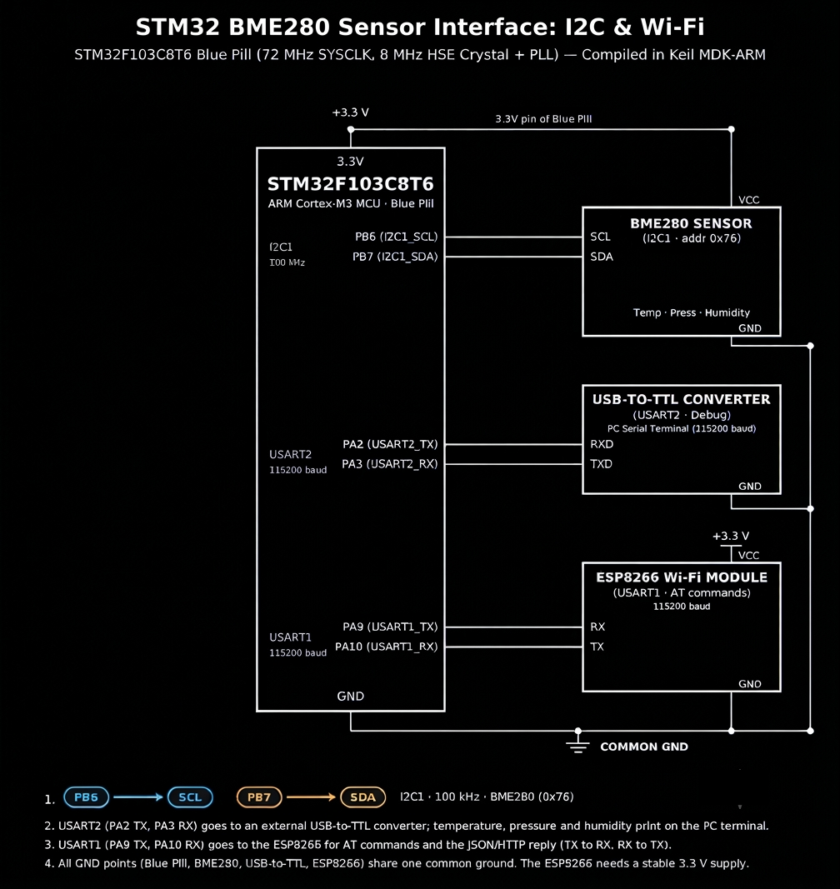

# Continuous Lab Evaluation - 13

**EXP:** Continuous Lab Evaluation - 13  
**DATE:** 27/10/2026  
**NAME OF EXP:** BME280 Sensor Interfacing Using I²C and Bosch Sensor API  
**HARDWARE SETUP / PLATFORM:** STM32F103 + BME280 Environmental Sensor (I2C1: PB6 SCL, PB7 SDA) + USB-UART Serial Monitor  
**TASK NO:** 13  

---

### Circuit Diagram


---

### Core Logic

* **1. Hardware I²C Driver Abstraction**  
  Maps the official Bosch Sensortec API callbacks (`read`, `write`, `delay_us`) to STM32 HAL memory transactions (`HAL_I2C_Mem_Read` and `HAL_I2C_Mem_Write` with 7-bit address left-shifted by 1):
  ```c
  int8_t bme_i2c_bus_read(uint8_t reg_addr, uint8_t *reg_data, uint32_t len, void *intf_ptr) {
      uint8_t dev_id = *(uint8_t *)intf_ptr;
      return (HAL_I2C_Mem_Read(&hi2c1, (dev_id << 1), reg_addr, I2C_MEMADD_SIZE_8BIT, reg_data, len, 500) == HAL_OK) ? BME280_OK : BME280_E_COMM_FAIL;
  }
  ```

* **2. Factory Calibration & Normal Mode Filtering**  
  `bme280_init()` retrieves chip-specific trimming parameters. Setting 16x IIR filtering and 62.5 ms standby produces stable, low-noise atmospheric measurements.

* **3. Calibrated Output Formatting**  
  Pulls raw ADC data, applies factory compensation equations, and reports temperature (°C), barometric pressure (hPa), and relative humidity (% RH) via serial console.

---

### Inference
Bridging vendor sensor APIs with STM32 HAL drivers ensures high-precision mathematical compensation without manual bit-unpacking, producing laboratory-grade atmospheric measurements.
