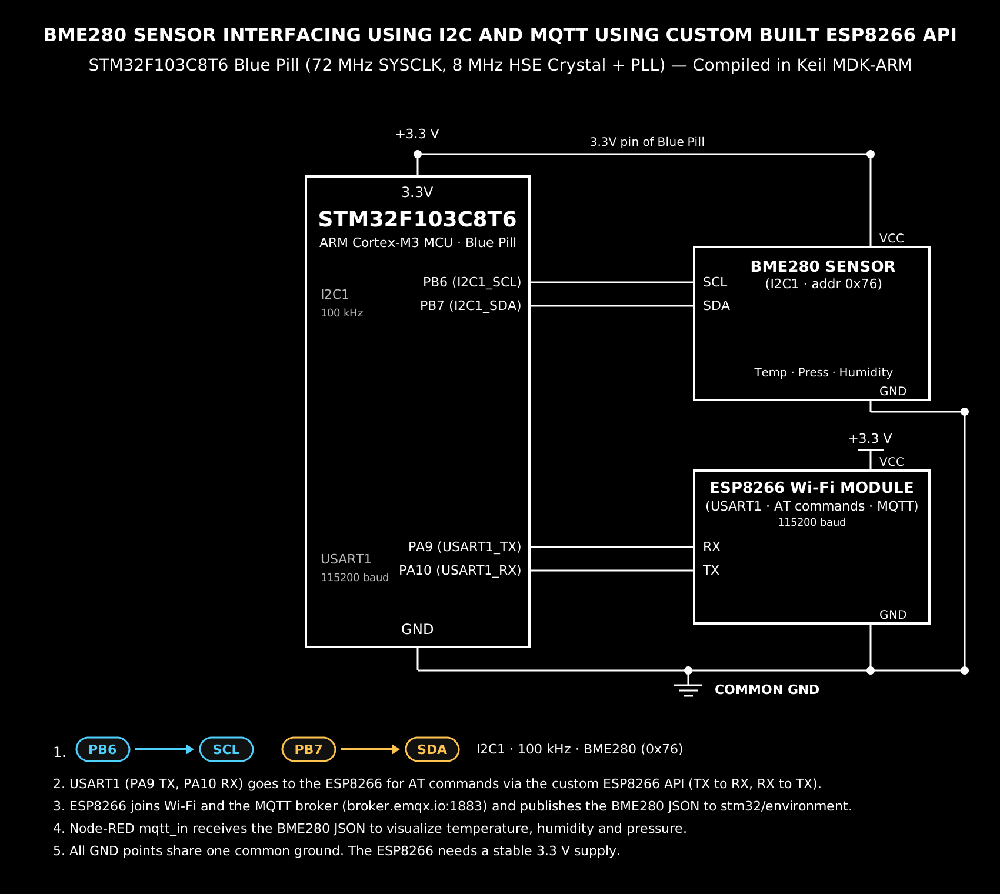

# Continuous Lab Evaluation - 14

**EXP:** Continuous Lab Evaluation - 14  
**DATE:** 03/11/2026  
**NAME OF EXP:** Sensor Interfacing (BME280) – MQTT Telemetry – Node Analytics  
**HARDWARE SETUP / PLATFORM:** STM32F103 + BME280 (I²C) + ESP8266 (UART) + Public MQTT Broker (`broker.emqx.io`)  
**TASK NO:** 14  

---

### Circuit Diagram


---

### Core Logic

* **1. Synchronous Sensor Acquisition**  
  Samples calibrated atmospheric data (temperature, pressure, humidity) from the BME280 over I2C1 every 5000 ms using the Bosch Sensortec driver.

* **2. JSON Telemetry Serialization & MQTT Publication**  
  Serializes telemetry into structured JSON payloads and publishes to topic `stm32/telemetry/bme280`:
  ```json
  {"device":"STM32-IoT","temp":25.40,"press":1012.35,"hum":58.20}
  ```

* **3. Remote Actuation via MQTT Ingress**  
  Subscribes to topic `stm32/control`. Inbound `"ON"` and `"OFF"` payloads trigger the `MQTT_MessageReceivedCallback()`, toggling the onboard LED:
  ```c
  void MQTT_MessageReceivedCallback(char *topic, char *payload) {
      if (strcmp(topic, "stm32/control") == 0) {
          if (strcmp(payload, "ON") == 0) HAL_GPIO_WritePin(GPIOC, GPIO_PIN_13, GPIO_PIN_RESET);
          else if (strcmp(payload, "OFF") == 0) HAL_GPIO_WritePin(GPIOC, GPIO_PIN_13, GPIO_PIN_SET);
      }
  }
  ```

---

### Inference
Demonstrates an end-to-end industrial IoT edge architecture: local sensor acquisition, standardized JSON serialization, wireless MQTT uplink, and remote cloud-commanded actuation with bidirectional telemetry.
